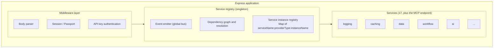
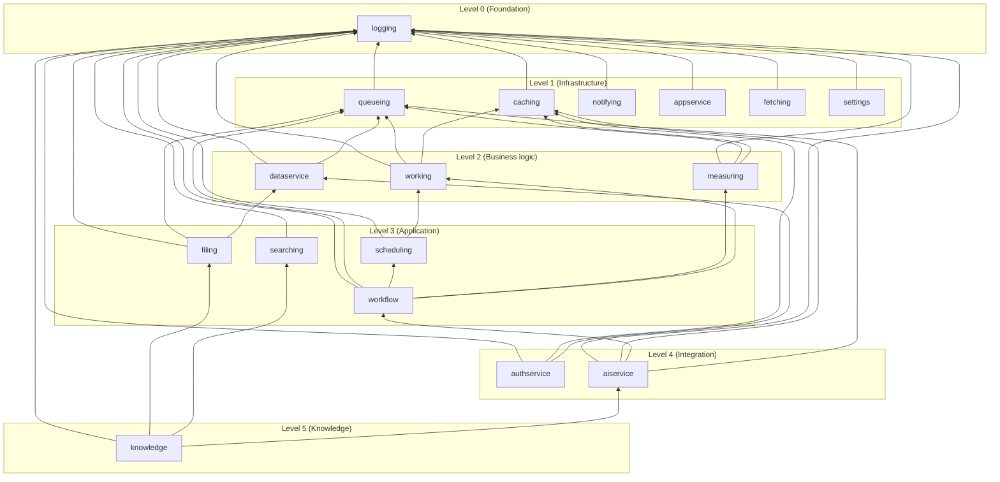
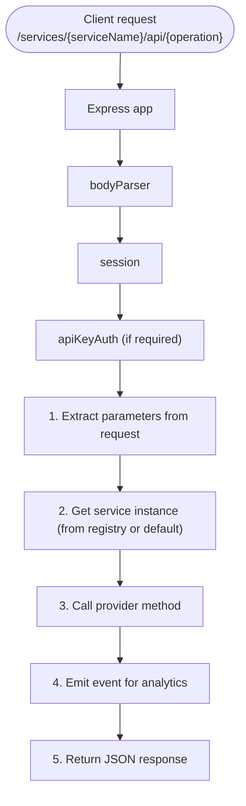
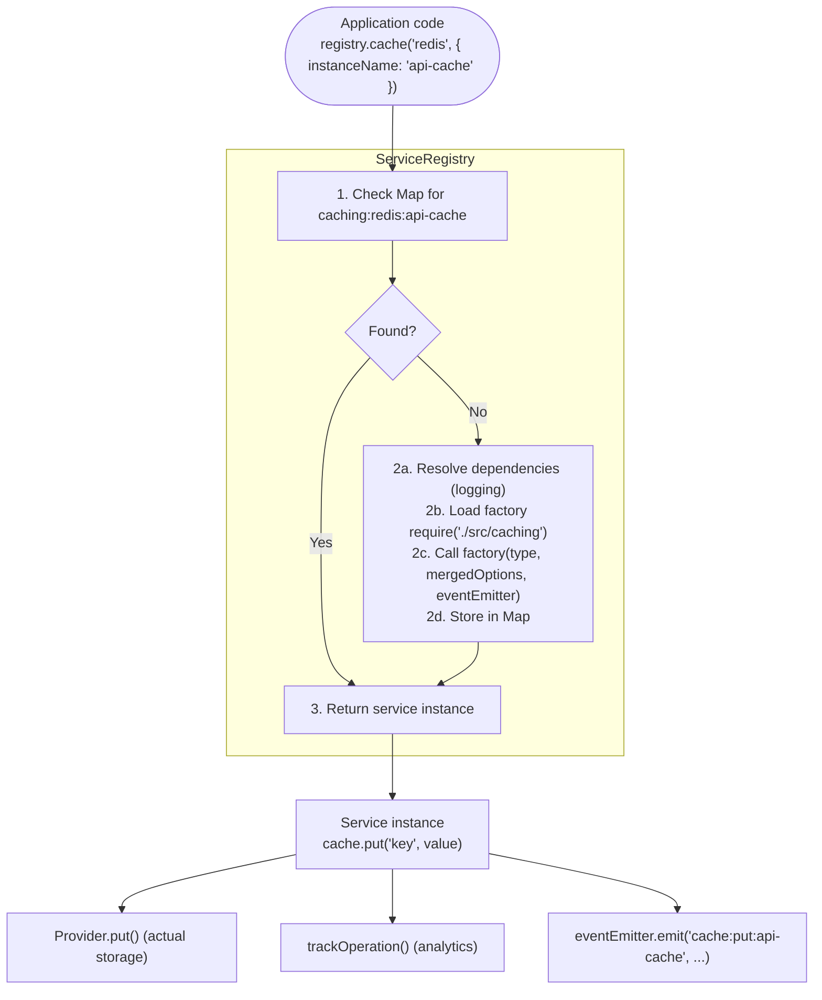
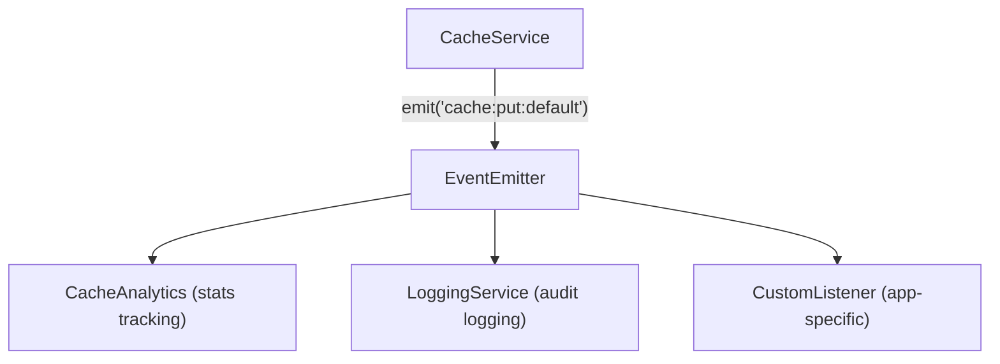
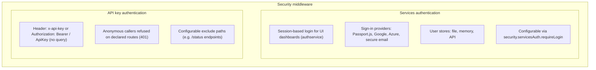
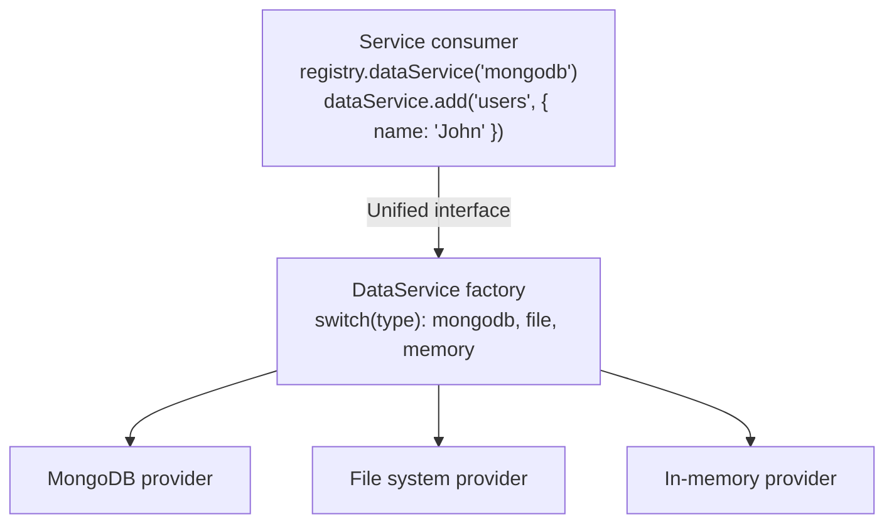
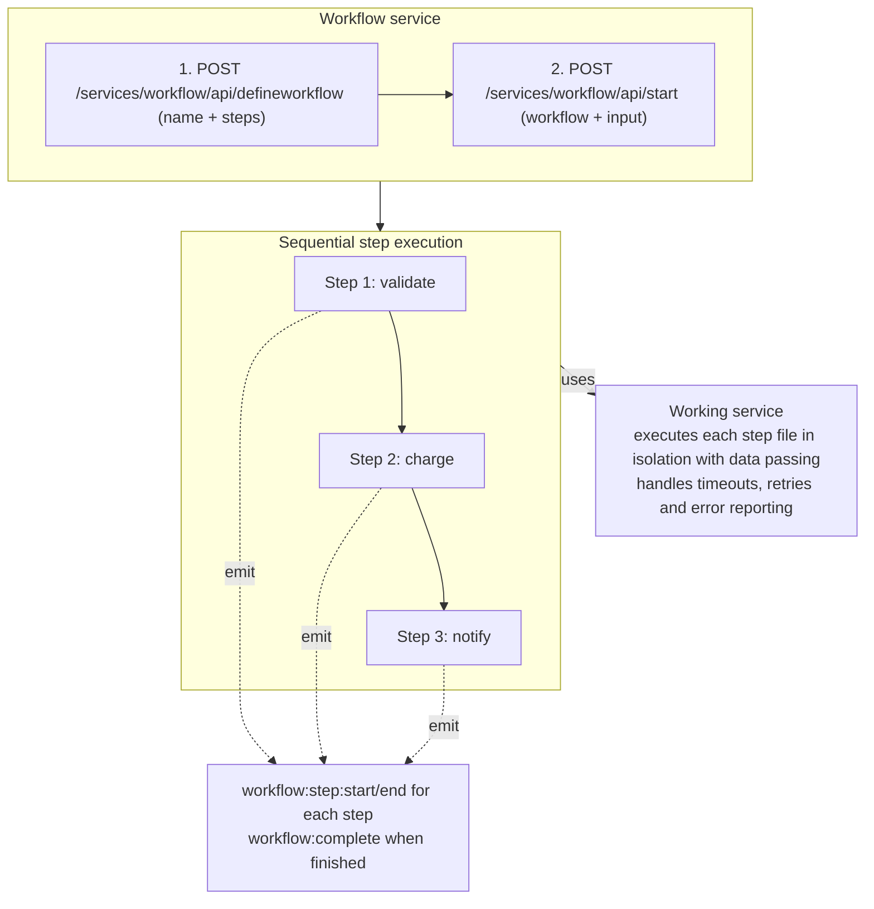
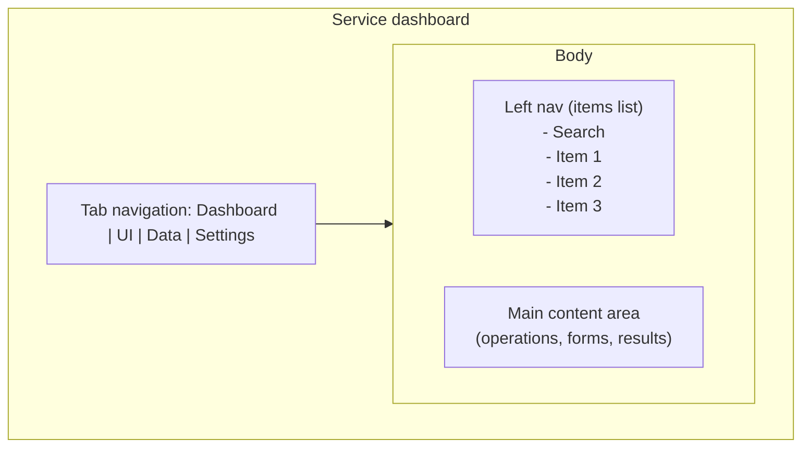

# Architecture Documentation

This document describes the architecture of NooblyJS Core, a modular Node.js backend framework providing enterprise services with singleton pattern implementation.

## High-Level Overview



## Service Registry Pattern

The `ServiceRegistry` class (`index.js`) is the central orchestrator implementing:

### Singleton Management
```javascript
// Services stored in a Map with composite keys
this.services = new Map();  // key: "serviceName:providerType:instanceName"
```

### Factory Methods
Each service type has a convenience factory method:
```javascript
registry.logger('file')       // -> getService('logging', 'file', {})
registry.cache('redis')       // -> getService('caching', 'redis', {})
registry.dataService('mongodb') // -> getService('dataservice', 'mongodb', {})
```

### Multi-Instance Support
Services can have multiple named instances:
```javascript
const sessionCache = registry.cache('redis', { instanceName: 'session-cache' });
const dataCache = registry.cache('redis', { instanceName: 'data-cache' });
```

## Dependency Injection System

### Dependency Hierarchy (Levels 0–5)

Dependencies are defined in `initializeServiceDependencies()` (`index.js`), which is the source of truth, and form a directed acyclic graph:



`registry.knowledge()` creates its own vector search instance (`instanceName: 'knowledge'`) unless `options.dependencies.searching` is given, so the knowledge index never mixes with the app's own search indexes.

`searching` declares only `logging` as a registry dependency. Its other collaborators (caching, dataservice, and so on) are chosen by the application, not injected by the registry. `validateDependencies()` rejects a circular graph (`getServiceInitializationOrder()` throws "Circular dependency detected").

### Dependency Resolution

When a service is requested, `getService(serviceName, providerType, options)` does the following:
1. Builds the key `serviceName:providerType:instanceName` (`instanceName` defaults to `'default'`) and returns the cached instance if it exists
2. Resolves dependencies recursively with `resolveDependencies()`; each dependency uses its default provider (see below)
3. Merges `globalOptions`, the call-site options, `dependencies`, `instanceName`, a `ServiceRegistry` reference and `providerType` into one options object
4. Loads `src/{serviceName}` and calls its factory; a failure emits `service:creation-error` and is re-thrown with context
5. Caches the instance and emits `service:created` with the dependency names

Injected dependencies use `getDefaultProviderType()`, not the provider of the service being created. The built-in defaults are `memory` for most services, with exceptions such as `filing` → `local`, `authservice` and `settings` → `file`, `aiservice` → `claude` and `fetching` → `node`. Call `setDefaultProvider(serviceName, providerType, options)` before anything that depends on the service is created, because resolved dependencies are cached.

```javascript
// In a service factory (e.g., src/caching/index.js)
function createCache(type, options, eventEmitter) {
  const { dependencies = {}, ...providerOptions } = options;
  const logger = dependencies.logging;  // Injected dependency

  let cache;
  switch (type) {
    case 'redis': cache = new CacheRedis(providerOptions, eventEmitter); break;
    // ... other providers ...
    case 'memory':
    default:      cache = new Cache(providerOptions, eventEmitter); break;
  }

  if (logger) {
    cache.logger = logger;   // plus a cache.log() wrapper that tags messages with [CACHE:<TYPE>]
  }
  cache.dependencies = dependencies;

  const instanceName = providerOptions.instanceName || 'default';
  cache.analytics = new CacheAnalytics(eventEmitter, instanceName);

  Routes(options, eventEmitter, cache);
  Views(options, eventEmitter, cache);
  return cache;
}
```

## Service Anatomy

Each service follows a consistent structure:

```
src/{serviceName}/
├── index.js              # Factory function (entry point), switches on provider type
├── providers/
│   ├── {service}.js      # Default (memory) provider
│   ├── {service}Redis.js # Redis provider (also {service}AWS.js, {service}Api.js, ...)
│   └── ...               # Additional providers
├── routes/
│   ├── index.js          # REST API under /services/{service}/api
│   └── swagger/          # Swagger docs for the API
├── views/
│   ├── index.js          # Static mount of the dashboard assets
│   └── index.html        # Dashboard UI
├── scripts/
│   ├── index.js          # Static mount of the browser client library
│   └── js/index.js       # Browser client library (where the service has one)
├── modules/
│   └── analytics.js      # Analytics tracker subscribed to the shared event bus
└── services/             # Optional service-level helpers (e.g. caching)
```

Not every service has every folder. Known exceptions: `aiservice` keeps its provider classes in `provider/` (singular) and its AI module in `common/`; `settings` has a single `providers/settings.js` serving both the `file` and `encrypted` types; `appservice` has `baseClasses/` and `utils/` for building custom app services and has no providers directory of its own. Each service's `index.js` is the authoritative list of provider names.

### Factory Function Pattern

Every service exports a factory function:

```javascript
function createService(type, options, eventEmitter) {
  const { dependencies = {}, ...providerOptions } = options;

  let service;
  switch (type) {
    case 'redis':
      service = new ServiceRedis(providerOptions, eventEmitter);
      break;
    case 'memory':
    default:
      service = new Service(providerOptions, eventEmitter);
      break;
  }

  // Inject dependencies
  service.dependencies = dependencies;
  if (dependencies.logging) {
    service.logger = dependencies.logging;
  }

  // Initialize analytics
  service.analytics = new ServiceAnalytics(eventEmitter, options.instanceName);

  // Register routes and views
  Routes(options, eventEmitter, service);
  Views(options, eventEmitter, service);

  return service;
}

module.exports = createService;
```

### Provider Interface

All providers for a service implement a common interface:

```javascript
class CacheProvider {
  constructor(options, eventEmitter) { }

  async put(key, value) { }
  async get(key) { }
  async delete(key) { }

  getAnalytics() { }
  async getSettings() { }
  async saveSettings(settings) { }
}
```

## Request Flow

### HTTP Request Lifecycle



### Service Call Flow



## Event-Driven Architecture

### Global Event Emitter

All services share a global EventEmitter for:
- Inter-service communication
- Analytics tracking
- Lifecycle notifications
- Debugging and monitoring

### Event Naming Conventions

```
{service}:{operation}:{instanceName}   # Service operations
  cache:put:default
  cache:get:api-cache
  log:info:default

{service}:created                      # Lifecycle events
workflow:defined
workflow:start
workflow:complete
workflow:error

api-auth-setup                         # System events
api-auth-warning
dependencies:initialized
```

### Event Flow Example



## Security Architecture

### Authentication Layers



### Authorization

Authorization has two layers that both apply to `/services`:

1. **Portal guard** (`servicesAuth`): only admins get through to `/services`: an admin session, an admin API key, or (on API paths only: `/services/*/api/*`, `/services/api/*`, `/services/mcp`) a personal access token, sent as a Bearer header, whose owner is an admin. Login, registration and the other public authentication routes are exempt. The guard does not set `req.user` for a token, so the token's scopes still apply at the next layer.
2. **Route permission gate** (`createPermissionGate`, feature 19): every `/services/*/api` request needs the permission its route declares in `src/authservice/config/routePermissions.js`. The gate uses:
   - the roles of a session or a personal access token (`ROLE_PERMISSIONS` in `src/authservice/modules/permissions.js`: `admin`, `editor`, `user`);
   - the scopes of an API key (a string key is full access; an object key carries `scopes`);
   - the scopes of a personal access token, which can only narrow its owner's permissions (`validateTokenScopes`, checked when the token is created and again at the gate).

In strictAuth mode (on by default in production) a route with no declaration is refused except to admins, and `ServiceRegistry.verifyRouteDeclarations()` fails start-up. The authorization matrix (`tests/unit/security/generatedAuthMatrix.test.js`) is generated from the declarations and runs on every test run.

3. **MCP tools** (`src/mcp/index.js`): each tool repeats the permission check of the REST route it mirrors, and write tools need `mcp.allowWrite` and the admin wildcard.

In production, a general (non-admin) API key does not pass the portal guard, so it cannot call `/services/*/api` either while `requireLogin` is on; configure admin keys (`security.servicesAuth.apiKeys`) for programmatic access.

### Request Protections

- **Anonymous refusal.** When API keys are required, a declared non-public route refuses a caller with no identity (`401 MISSING_API_KEY`), whether or not the service has its own key check. Excluded paths (`DEFAULT_EXCLUDE_PATHS` in `src/authservice/middleware/apiKey.js`) stay open.
- **Cross-site writes.** `createOriginCheck()` (`src/authservice/middleware/originCheck.js`) refuses state-changing requests that carry only the session cookie when their `Origin` or `Referer` is another site (`403 CSRF_ORIGIN_MISMATCH`, event `auth:csrf-origin-rejected`). It is on by default; `security.csrf.enabled: false` turns it off.
- **Invitations.** An invitation code is revoked after five failed redeems (`INVITATION_MAX_FAILED_REDEEMS` or the `maxFailedRedeems` option). The revocation emits `auth:invitation-revoked`.
- **Code execution boundary.** Activities run only from a folder that does not overlap any registered filing store (`src/working/modules/filingRoots.js`); Windows-style paths are refused on every platform. `assertActivityPath()` applies the containment check on the HTTP and workflow paths.

### Middleware Chain Setup

```javascript
// In ServiceRegistry.initialize()
this.authMiddleware = createApiKeyAuthMiddleware({
  apiKeys,
  requireApiKey,
  excludePaths
}, eventEmitter);

this.servicesAuthMiddleware = createServicesAuthMiddleware(this);

// Route protection
app.get('/services/', this.servicesAuthMiddleware, handler);
app.post('/services/caching/api/put/:key', authMiddleware, handler);
```

## Data Flow Patterns

### Provider Abstraction



### Workflow Execution



## REST API Structure

### URL Pattern
```
/services/{serviceName}/api/{operation}[/{instanceName}][/{parameters}]
```

### Standard Endpoints

Every service typically exposes:

| Endpoint | Method | Auth | Description |
|----------|--------|------|-------------|
| `/services/{service}/api/status` | GET | No | Health check (every service) |
| `/services/{service}/api/analytics` | GET | Yes | Service metrics (most services) |
| `/services/{service}/api/settings` | GET | Yes | Configuration (most services) |
| `/services/{service}/api/settings` | POST | Yes | Update config (most services) |
| `/services/{service}/api/instances` | GET | Yes | List instances (where the service supports named instances, e.g. caching, logging, filing) |

Routes are not uniform across services. The merged OpenAPI 3.1 document at `/services/api/openapi.json` (also `.yaml`, rendered at `/services/api/docs`) lists every route of every mounted service: `src/shared/utils/openapi.js` merges each service's `routes/swagger/docs.json`. Every route is documented; `tests/unit/openapi/undocumentedRoutes.baseline.json` is empty, and the suite validates the document against the OpenAPI 3.1 schema.

Other registry-level endpoints: `/services/api/monitoring/{metrics,snapshot}`, `/services/api/mcp/status`, and `POST /services/mcp` when MCP is enabled.

### Service-Specific Examples

```
# Caching (the :instanceName segment is optional)
POST   /services/caching/api/put/:key
POST   /services/caching/api/:instanceName/put/:key
GET    /services/caching/api/get/:key
GET    /services/caching/api/:instanceName/get/:key
DELETE /services/caching/api/delete/:key
GET    /services/caching/api/:instanceName/list

# DataService (containers are created with POST; records are addressed by uuid)
POST   /services/dataservice/api/:container
GET    /services/dataservice/api/find/:container
GET    /services/dataservice/api/count/:container
GET    /services/dataservice/api/:container/:uuid
PUT    /services/dataservice/api/:container/:uuid
DELETE /services/dataservice/api/:container/:uuid
POST   /services/dataservice/api/jsonFind/:containerName

# Workflow (run API)
POST /services/workflow/api/defineworkflow
POST /services/workflow/api/start
GET  /services/workflow/api/definitions
GET  /services/workflow/api/executions/:workflowName

# Workflow manager (used by the dashboard UI; BASE = /services/workflow/api)
GET|POST       /services/workflow/api/workflows
GET|PUT|DELETE /services/workflow/api/workflows/:name
POST           /services/workflow/api/workflows/:name/execute
GET            /services/workflow/api/runs        (plus /runs/:id, /runs/stats, /runs/running; POST /runs/clear, POST /runs/:id/cancel)
GET|POST       /services/workflow/api/schedules   (plus /schedules/:id, /:id/toggle, /:id/run-now)
GET            /services/workflow/api/cron/preview
GET|PUT        /services/workflow/api/state       (export / import the in-memory snapshot)
```

## UI Dashboard Architecture

### Dashboard Structure

Each service provides a web dashboard at `/services/{serviceName}/`:



### Static File Serving

```javascript
// In views/index.js
app.use('/services/{serviceName}', express.static(path.join(__dirname)));

// Files served:
// /services/caching/                  -> views/index.html
// /services/caching/js/index.page.js  -> views/js/index.page.js
```

The CSP has no `unsafe-inline` for scripts. A dashboard's scripts are files its views module must serve (a script that 404s raises no page error, but every handler in it is missing), and buttons name their handler in `data-onclick` with JSON arguments in `data-onclick-args`; `/services/js/actions.js` calls the global function of that name. `tests/ui/handlers.spec.js` opens every dashboard and checks that each handler it can render resolves and that each page script loads. Styles still allow `unsafe-inline`.

## Monitoring & Observability

### System Monitoring

```javascript
// Endpoints provided by ServiceRegistry
GET /services/api/monitoring/metrics   // CPU, memory, uptime
GET /services/api/monitoring/snapshot  // Current system state
```

### Service Analytics

Each service tracks its own analytics:

```javascript
// Analytics module pattern
class ServiceAnalytics {
  constructor(eventEmitter, instanceName) {
    // Subscribe to service events
    eventEmitter.on(`service:operation:${instanceName}`, this.track.bind(this));
  }

  getStats() { }
  getTimeline(count) { }
  getHitDistribution(count) { }
}
```

## Shared Building Blocks

Some modules are used by more than one service, or by the NooblyJS AI host that consumes this package. They are not services and are not registered in the dependency graph.

| Module | Purpose |
|--------|---------|
| `src/shell/` | `createShell()` (rail, sidebar, status cards and the frame page handler) and `css-scope.js`. `scripts/scope-css.js` scopes an app's stylesheet under `[data-module="<name>"]`. Used by the NooblyJS host and by hosted apps' standalone servers; not mounted by `app.js`. |
| `public/ui/` | The UI kit served at `/ui/`: tokens, base, component and shell CSS, `frame.html` and ES modules (`html`, `icons`, `api`, `router`, `sse`, `chat`, `components/`). Figtree, Bricolage Grotesque and JetBrains Mono are self-hosted under SIL OFL. |
| `src/store/fs-store.js` | `FsStore`, a files-only store: Markdown with YAML front matter, YAML config, atomic tmp-and-rename writes, per-path locks and path-segment validation. |
| `src/aiservice/common/` | `nooblyjs-ai-common`, an ESM package inside this CommonJS repo with its own `package.json`. It gives one way to call every model provider (Anthropic, OpenAI, OpenAI-compatible, mock, AWS Bedrock, Google Vertex AI, Azure), plus the model catalogue, discovery, tokens, cost, retry and SSE. It has no dependencies. Projects link it with `file:<path>/src/aiservice/common`. Tests: `npm run test:ai-common`; type check: `npm run check:ai-common`. |
| `src/shared/utils/routePattern.js` | `route()` turns an Express 4 pattern (`*`, `:name(*)`, `:opt?`) into patterns that Express 4 and 5 both accept. Use it for any route with a wildcard or optional parameter. |
| `src/shared/utils/httpErrors.js`, `safeError.js` | `ClientError` for client-safe 4xx errors and `sendSafeError()` / `toClientResponse()` so that server faults never leak `err.message`. |
| `src/shared/utils/validation.js` | `validate({ body, query, params })` and the list-size helpers `parseLimit`, `capLimit` and `parseOffset`. |
| `src/shared/utils/contentSecurityPolicy.js` | The CSP policy applied by `app.js` / `app-noauth.js`. A new external script, style or font origin must be added here. |
| `src/shared/utils/sessionStore.js`, `createServer.js`, `trustSystemCa.js` | Session stores (a pruning in-process store, or Redis when `SESSION_REDIS_URL` / `REDIS_URL` is set), the HTTP/HTTPS server factory (`HTTPS_ENABLED`), and trust of the operating-system CA store for outbound TLS behind inspecting proxies. |
| `src/authservice/modules/redirect.js` | `safeReturnUrl()` and `postLoginRedirect()`: after sign-in a person returns to the page they were heading to (same-origin paths only), then `loginSuccessRedirectUrl`, then `/services`. |
| `src/views/js/navigation.js` | The dashboard's service navigation list (`NooblyJSNavigation`). A new service must be added here to appear in the dashboard. |
| `src/mcp/` | The MCP endpoint (`POST /services/mcp`, JSON-RPC over Streamable HTTP): read and write tools, resources and prompts, each tool checked against its REST route's permission. Mounted by the registry when `mcp.enabled`. |
| `src/cli/`, `bin/nooblyjs.js` | The `nooblyjs` command: `create`, `add endpoint|service|provider`, `doctor`, `routes`, `openapi` (and the typed client generator `tsClient.js`), `keys`, `mcp` (stdio bridge). |
| `src/testing/`, `testing.js` | The test kit, exported as `nooblyjs-core/testing`: `createTestRegistry()`, `installMatchers()`, `EventRecorder`. |
| `src/shared/utils/openapi.js`, `rankingEval.js` | The OpenAPI merge (`buildOpenApiDocument`, undocumented-route stubs) and recall@k / mean reciprocal rank scoring shared by searching's evaluate route and the knowledge service. |

## Extension Points

### Adding a New Service

1. Create service directory: `src/newservice/`
2. Implement factory function: `src/newservice/index.js`
3. Add providers: `src/newservice/providers/`
4. Register routes: `src/newservice/routes/index.js` (with Swagger docs under `routes/swagger/`)
5. Add views: `src/newservice/views/`
6. Define dependencies in `index.js:initializeServiceDependencies()`
7. Add factory method in `ServiceRegistry` class
8. Add the service to the navigation list in `src/views/js/navigation.js`
9. Set `service.analytics` on the instance when the factory subscribes to the shared EventEmitter, so `ServiceRegistry` can call `analytics.destroy()` on reset or shutdown (`tests/unit/registryListenerLeak.test.js` guards this)
10. Declare every `/services/{service}/api` route in `src/authservice/config/routePermissions.js` (strictAuth refuses undeclared routes) and document it in `routes/swagger/docs.json` (an undocumented route fails the OpenAPI drift test)

### Adding a New Provider

1. Run `npx nooblyjs add provider <service> <name>` (caching, queueing, filing, dataservice, searching, authservice): it writes the provider class with a stub for each method the contract calls, and `tests/contract/{service}.{name}.test.js`
2. Add the printed case to the factory's switch statement
3. Implement until the contract passes; a provider that needs a live backend skips its runner unless an environment variable is set (see `tests/contract/cache.redis.test.js`)
4. Add provider-specific tests in `tests/unit/{service}/`

### Custom Middleware

```javascript
// Add custom middleware before service initialization
app.use('/services/*', customMiddleware);

// Or configure via options
serviceRegistry.initialize(app, eventEmitter, {
  security: {
    apiKeyAuth: { /* custom config */ },
    servicesAuth: { /* custom config */ }
  }
});
```
