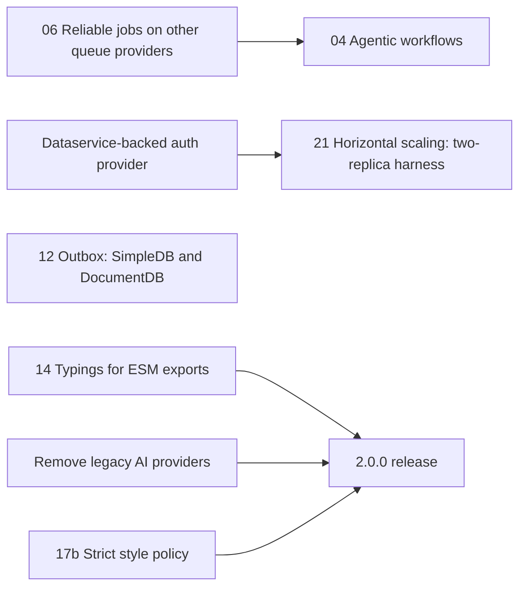

# NooblyJS Core Roadmap

**Updated:** 2026-11-16 · **Owner:** NooblyJS Core team · **Review:** monthly
**Sources:** [Engineering acceleration features](features/00.%20Roadmap%20-%20Engineering%20Acceleration.md) · [Production readiness and security review 2026-11-12](go-to-market/PRODUCTION_READINESS_REVIEW_2026-11-12.md)

This page lists only work that is still open. Completed phases, features and measures were removed; each feature spec's status line keeps the evidence for what was delivered.

## Open work

### Before the next release

These come from the phase 1 merge (2026-11-16) and gate a release:

- **Staging check of the new refusals.** Anonymous callers are refused on declared, non-public API routes whenever API keys are required, and cross-site cookie writes are refused by default (`security.csrf.enabled=false` opts out). Both are covered by tests, but neither has run against a deployment yet.
- **Allow-side authorization matrix.** The matrix test checks only that callers are refused where permissions deny. The allow-side checks were dropped because the phase 1 role table differs from main's. Restore them against the current role table.
- **SSRF redirect bypass (security, fix first).** The fetching guard checks only the requested URL. The Node provider follows redirects, and the redirect target is not checked. Confirmed locally: with `ssrf.allowedHosts: ['localhost']`, a `localhost` URL that redirects to `127.0.0.1` returns the private server's body, while a direct request to `127.0.0.1` is refused. Fix: `redirect: 'manual'` and re-validate each hop, with a regression test for this case.
- **Next release.** `v1.2.0` is tagged. The phase 1 merge (after the tag) is unreleased; tag the next version once CI is green on `main`.

### Phase 3: scale and completeness

| # | Change | Status | Remaining work | Effort |
|---|---|---|---|---|
| 04 | [Agentic workflows](features/04.%20Feature%20Agentic%20Workflows.md) | Not started | AI, agent, approval and branch steps with durable state. Moves forward if a customer needs agentic automation sooner. | L |
| 21 | [Horizontal scaling readiness](features/21.%20Feature%20Horizontal%20Scaling%20Readiness.md) | Partly done | Two-replica harness, which waits on a dataservice-backed auth provider. | M |
| 07 | [OpenTelemetry observability](features/07.%20Feature%20OpenTelemetry%20Observability.md) | Partly done | Queue-depth metrics are not measured yet. | S |
| 12 | [Webhooks and transactional outbox](features/12.%20Feature%20Webhooks%20and%20Outbox.md) | Partly done | Transactional outbox for SimpleDB and DocumentDB. | M |
| 14 | [Express 5, ESM and Node 22](features/14.%20Feature%20Express%205%20ESM%20and%20Node%2022.md) | Partly done | Typings for the named ESM exports. | S |

### Carried over from Phase 2 and earlier

- **Reliable jobs on other queue providers** (06): memory and Redis support them. RabbitMQ, ActiveMQ, AWS, Azure, GCP and the API proxy refuse reliable options with a clear 400. Native support needs a live service to build against.
- **Live-provider checks** (01, 05): semantic search against a real embedding provider, and knowledge answers evaluated with a real model.
- **S3 and cloud-provider contract tests** (11).
- **Strict style policy** (17b): styles still allow `'unsafe-inline'`. Scripts do not.
- **Developer CLI** (09): `add endpoint` and `add service` inside core.
- **MCP `tools/list`** filtered by the caller's permissions. Calls are already checked.

### Release 2.0.0

Express 5, ESM and Node 22 are in place. The 2.0.0 release also needs:

- The legacy AI providers removed (`claude`, `openai`, `ollama`, `gemini`). Until then they keep their old classes unless `legacy: false` is set.
- Strict CSP enforced by default (see the style policy above).

## Dependencies

## Measures still open

| Measure | Current | Target |
|---|---|---|
| Reliable-job support on queue providers | 2 of 8 (memory, Redis); RabbitMQ, ActiveMQ, AWS, Azure, GCP and the API proxy refuse with a 400 | Every provider, or an explicit refusal accepted for each |
| AI providers behind one API | 6 on AI Service v2 (anthropic, openai-compatible, bedrock, vertex, azure, mock); legacy names still present | Legacy names removed for 2.0.0 |
| Live-provider checks | 0 (embeddings, knowledge answers) | 1 each before the next minor release |
| Two-replica harness | Not built | Runs in CI |

## Housekeeping

- **Docs:** update `Application Architecture.md`, `Product Requirements.md`, the usage guides and the README at the end of each phase. Last checked against the code on 2026-11-16.
- **Trackers:** the review's finding table (`go-to-market/PRODUCTION_READINESS_REVIEW_2026-11-12.md`) and each spec's status line are the trackers.
- **Spec locations:** feature specs and the review live under `.claude/steering/` (`features/`, `go-to-market/`), as CLAUDE.md and `.claude/rules/output-locations.md` say.
- **Learning:** tutorials for each service live in `.claude/learning/`.
