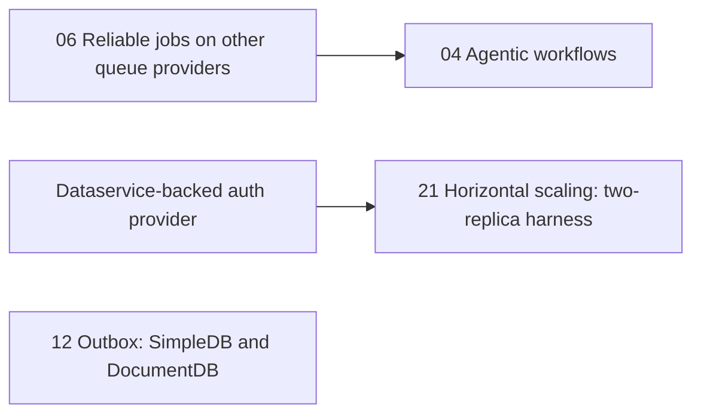

# NooblyJS Core Roadmap

**Updated:** 2026-11-17 · **Owner:** NooblyJS Core team · **Review:** monthly
**Sources:** [Engineering acceleration features](features/00.%20Roadmap%20-%20Engineering%20Acceleration.md)

This page lists only work that is still open. Completed phases, features and measures were removed; each feature spec's status line keeps the evidence for what was delivered.

## Open work

### Phase 3: scale and completeness

| # | Change | Status | Remaining work | Effort |
|---|---|---|---|---|
| 04 | [Agentic workflows](features/04.%20Feature%20Agentic%20Workflows.md) | Not started | AI, agent, approval and branch steps with durable state. Moves forward if a customer needs agentic automation sooner. | L |
| 21 | [Horizontal scaling readiness](features/21.%20Feature%20Horizontal%20Scaling%20Readiness.md) | Partly done | Two-replica harness, which waits on a dataservice-backed auth provider. | M |
| 07 | [OpenTelemetry observability](features/07.%20Feature%20OpenTelemetry%20Observability.md) | Partly done | Queue-depth metrics are not measured yet. | S |
| 12 | [Webhooks and transactional outbox](features/12.%20Feature%20Webhooks%20and%20Outbox.md) | Partly done | Transactional outbox for SimpleDB and DocumentDB. | M |

### Carried over from Phase 2 and earlier

- **Reliable jobs on other queue providers** (06): memory and Redis support them. RabbitMQ, ActiveMQ, AWS, Azure, GCP and the API proxy refuse reliable options with a clear 400. Native support needs a live service to build against.
- **Live-provider checks** (01, 05): semantic search against a real embedding provider, and knowledge answers evaluated with a real model.
- **S3 and cloud-provider contract tests** (11).
- **Developer CLI** (09): `add endpoint` and `add service` inside core.
- **MCP `tools/list`** filtered by the caller's permissions. Calls are already checked.

## Dependencies

## Measures still open

| Measure | Current | Target |
|---|---|---|
| Reliable-job support on queue providers | 2 of 8 (memory, Redis); RabbitMQ, ActiveMQ, AWS, Azure, GCP and the API proxy refuse with a 400 | Every provider, or an explicit refusal accepted for each |
| Live-provider checks | 0 (embeddings, knowledge answers) | 1 each before the next minor release |
| Two-replica harness | Not built | Runs in CI |

## Housekeeping

- **Docs:** update `Application Architecture.md`, `Product Requirements.md`, the usage guides and the README at the end of each phase. Last checked against the code on 2026-11-17.
- **Trackers:** each feature spec's status line is the tracker. The 2026-11-12 review was removed from the repo (commit 2695cf8); its findings are closed.
- **Spec locations:** feature specs live under `.claude/steering/features/`, as CLAUDE.md and `.claude/rules/output-locations.md` say.
- **Learning:** tutorials for each service live in `.claude/learning/`.
