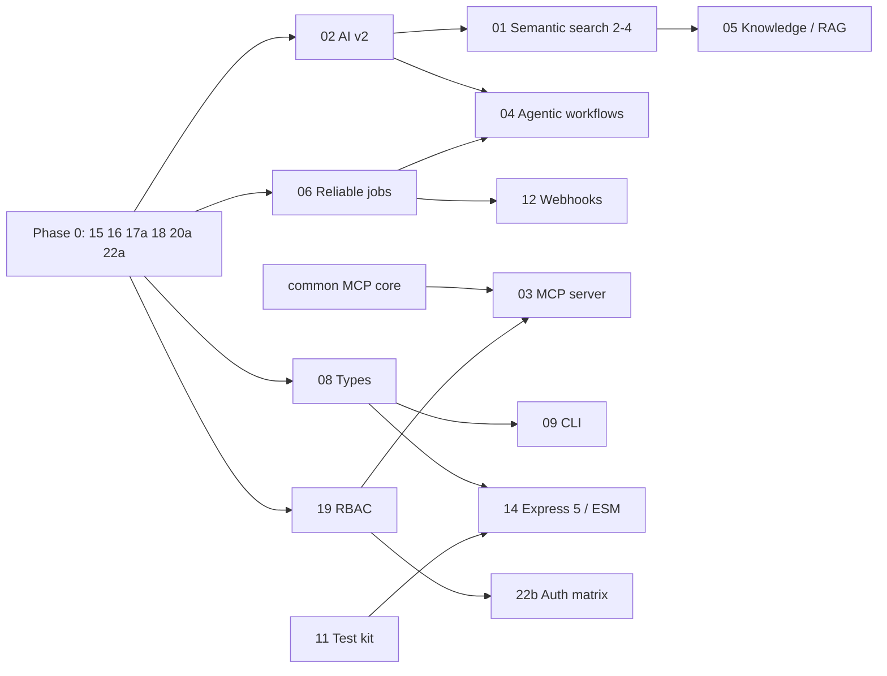

# NooblyJS Core Roadmap

**Created:** 2026-11-12 · **Owner:** NooblyJS Core team · **Review:** monthly
**Sources:** [Engineering acceleration features](../specs/features/00.%20Roadmap%20-%20Engineering%20Acceleration.md) · [Production readiness and security review 2026-11-12](../specs/go-to-market/PRODUCTION_READINESS_REVIEW_2026-11-12.md) · [Semantic search](./features/01.%20Feature%20Searching%20Service%20Semantic%20Search.md)

## Why this order

Rank work by **impact ÷ effort**, but treat anything that blocks safe release as a gate, not a ranking:

1. **Can we ship it safely?** A reproduced chain lets an anonymous visitor read and write server files, and CI is red on dependency advisories. Nothing else matters to a customer until this is fixed.
2. **Does it unblock other work?** AI Service v2, reliable jobs and types each unblock several later features.
3. **Will engineers feel it every day?** The MCP server, knowledge service, CLI and OpenAPI change how fast teams build.
4. **Is it completeness?** Webhooks, feature flags and the Express 5 move are valuable but can wait.

## Now — Phase 0: Safe to ship (weeks 1–3)

**Goal:** close every critical and high finding and get CI green. **Exit:** the review's reproduction fails at every step, `npm audit --omit=dev --audit-level=high` passes, and the security regression tests are in the suite.

**Status (2026-11-12): implemented on branch `security/phase-0` (pushed), not yet released.** 20a, 15, 16, 17a, 18 and 22a are done. `npm audit --omit=dev --audit-level=high` reports 0 advisories, and `tests/unit/security/exploitChain.test.js` (31 tests, 24 of which fail on the pre-fix code) passes with the full Jest suite. Still open before tagging 1.0.11: the Playwright UI run (not run, because Chromium wasn't installed), email delivery for invitation codes (the `sendCode` hook exists; the notifying mail transport does not), the per-code failed-redeem counter, and the `TRUST_PROXY` rate-limiter IP test from 20a.

| # | Change | Impact | Effort |
|---|---|---|---|
| 20a | [Fix dependency advisories](../specs/features/20.%20Feature%20Dependency%20and%20Supply-Chain%20Hygiene.md) (`npm audit fix`, `simple-git` 4, `proxy-addr`) | CI green again; removes command-execution and IP-spoofing advisories | S |
| 15 | [Filing authorization and locked settings](../specs/features/15.%20Feature%20Filing%20Authorization%20and%20Locked%20Settings.md) | Closes C-1: arbitrary file read and write | M |
| 16 | [Invitation and onboarding hardening](../specs/features/16.%20Feature%20Invitation%20and%20Onboarding%20Hardening.md) | Closes C-2: anyone can create an account | S–M |
| 18 | [Code execution boundary](../specs/features/18.%20Feature%20Code%20Execution%20Boundary.md) | Closes H-3: any admin session or key can run any script | S–M |
| 17a | [Safe content serving](../specs/features/17.%20Feature%20Safe%20Content%20Serving%20and%20Strict%20CSP.md) (attachments for active types, sandbox header, safe type list) | Closes H-1: stored XSS against admins | S |
| 22a | [Exploit-chain regression tests](../specs/features/22.%20Feature%20Security%20Regression%20Suite%20and%20Continuous%20Verification.md) | Keeps the fixes fixed | S |

**Until Phase 0 ships:** deploy only on a private network, restrict filing `allowedTypes`, configure separate admin API keys, and block the public invitation and filing-settings routes at the proxy.

## Next — Phase 1: Foundations (weeks 3–8)

**Goal:** the building blocks every later feature needs, plus least-privilege access. **Exit:** one AI API with streaming, tools and embeddings; at-least-once jobs; typed public API; every route declares a permission.

**Status (2026-11-12): done on branch `feature/phase-1`, stacked on `security/phase-0`; not yet released.** All seven features are in, the full Jest suite passes (2,374 tests, 80 skipped), and the exit criteria are met. Details per feature, including what was left out:

| # | State | Notes |
|---|---|---|
| 19 | **Done** | One permission table (`src/authservice/policy/routePermissions.js`) covers every registered `/services` API route (319 today), enforced whether or not the portal guard is on. Scoped static keys (`{ key, name, scopes }`), scoped personal tokens, custom roles (`security.roles`), `verifyRoutePermissions()` with `strictAuth` (default in production), and no data-plane-key access to the portal in production (closes M-1, L-1). Also closed the `excludePaths` `/services/*/status` hole. Not done: `requirePermission` in CLI templates (feature 09); moving the filing tiers onto the permission map. |
| 23 | **Done** | No session tokens in URLs or `localStorage`: the query `authToken` is gone from every middleware and dashboard, and the login pages use the cookie session plus `GET /services/authservice/api/session` and a one-time `POST …/session/handoff`. Idle timeouts (8 h, 30 min for admins) and a 24 h absolute lifetime for cookie and token sessions; sessions are revoked when a password, role or active flag changes. CSRF defence by Origin/Referer check on cookie-authenticated writes, `Referrer-Policy: no-referrer`. Personal tokens expire after 90 days by default (`tokens.*`), and admins can list and revoke a user's tokens. Closes M-2. 14 tests in `sessionHygiene.test.js`. |
| 02 | **Done** | `aiservice('anthropic' \| 'openai-compatible' \| 'grok' \| 'deepseek' \| 'bedrock' \| 'vertex' \| 'azure' \| 'mock')` runs on nooblyjs-ai-common: `complete`, `stream` (SSE via `streamToResponse`), tools, `generateObject` (JSON Schema checked, one repair retry, 422 `AI_INVALID_OBJECT`), `embed` (OpenAI, Gemini, Ollama, Bedrock, Vertex, mock; new `embeddings.js` in ai-common), cost per call, `maxCostPerDay` and `maxTokensPerRequest` budgets. REST: `POST /services/ai/api/{complete,stream,object,embed}`. A Playground tab with streaming and usage by model. The legacy names (`claude`, `openai`, …) keep their classes until 2.0, or use v2 with `legacy: false`. Jest now runs with `--experimental-vm-modules` so CommonJS can import the ESM package. Not done: live checks against real providers; removing the legacy SDKs (2.0). |
| 06 | **Done** | `queue.enqueue(name, data, { delayMs, attempts, backoff, idempotencyKey, priority })` returns a job id; `queue.process(name, handler, { concurrency, visibilityTimeoutMs })` gives at-least-once delivery with visibility timeouts, keep-alive, retries with backoff, a dead-letter queue (`listDeadLetters`, `retryDeadLetters`), and graceful drain on `shutdown()`. Memory and Redis stores (atomic claim in Lua), one contract suite run against memory, ioredis-mock and a real Redis (in CI). REST under `/services/queueing/api/jobs` and a Jobs tab. `working.start(…, { attempts, backoff })` retries. Not done: native SQS, Azure, RabbitMQ, GCP and ActiveMQ job stores (they throw clearly, or opt into the in-process store), and running the working service fully on the job queue. |
| 08 | **Done** | `types/index.d.ts`: per-provider overloads for every factory and interfaces for every service, including AI v2 and jobs (`package.json` `types`). `npm run check:types` compiles every concise usage-guide example plus the Phase 1 APIs with `strict: true`, with `@ts-expect-error` cases for bad provider names, option types and priorities. Every service with provider options has an `options.schema.js`; `getService()` warns on a misspelt key with a suggestion ("did you mean `redisUrl`?"), throws on a wrong type, and `strictOptions: true` makes warnings errors. Canonical camelCase names (`redisUrl`, `redisPort`, `memcachedUrl`) map onto the legacy spellings, which now warn. |
| 22b | **Done** | `authorizationMatrix.test.js` calls all 319 API routes as anonymous, user, admin, a scoped key and an unscoped key, with handlers stubbed so only the gates are measured; it runs with the permission layer alone and in the `app.js` configuration. `npm run probe -- --url …` runs 48 live checks (passes 48/48 against the production image, fails 29/40 against `app-noauth`) and runs in CI against the Docker image together with an OWASP ZAP baseline (`.zap/rules.tsv`, 0 failing alerts today). gitleaks scans history in CI against a redacted baseline. Jest fails the run if it creates files outside `.temp/`. Found and fixed: the AI `health` route was declared public but needed a key, and in production `app.js` could not configure admin keys at all (new `ADMIN_API_KEYS`). The September 70-check list is not in the repository, so the probe was rebuilt from the 2026-11-12 review. |
| 20b | **Done** | 17 cloud SDKs and broker clients are optional peer dependencies loaded only when their provider is chosen, with an install hint when missing (`requireOptional`). A clean install adds 132 packages instead of 494. Nightly audit of `main` opens a `security` issue on failure; Dependabot (grouped weekly minor/patch, auto-merged when CI passes; needs auto-merge and required checks turned on in GitHub); release workflow with a CycloneDX SBOM and `npm publish --provenance` (needs an `NPM_TOKEN` secret). Not done: replacing abandoned `ftp`, `stompit`, `pdf-parse@1` and `@google-cloud/storage@5`; the nightly job has not run yet, because it runs only once the workflow is on the default branch. |

| # | Change | Impact | Effort |
|---|---|---|---|
| 02 | [AI Service v2 on nooblyjs-ai-common](../specs/features/02.%20Feature%20AI%20Service%20v2%20on%20AI%20Common.md) | One AI API for every provider; unblocks semantic search Phase 2, RAG and agents; drops two SDKs | M |
| 06 | [Reliable jobs](../specs/features/06.%20Feature%20Reliable%20Jobs.md) | Retries, dead-letter queue and a consumer API; no more lost jobs | M |
| 08 | [TypeScript types and validated config](../specs/features/08.%20Feature%20TypeScript%20Types%20and%20Validated%20Config.md) | Autocomplete for people and coding agents; typos caught at start-up | M |
| 19 | [Route-level RBAC and scoped API keys](../specs/features/19.%20Feature%20Route-Level%20RBAC%20and%20Scoped%20API%20Keys.md) | Least privilege everywhere; no single guard to get wrong | M–L |
| 23 | [Session and token hygiene](../specs/features/23.%20Feature%20Session%20and%20Token%20Hygiene.md) | No tokens in URLs or script; idle timeouts | S–M |
| 22b | [Authorization matrix, ZAP baseline, secret scanning](../specs/features/22.%20Feature%20Security%20Regression%20Suite%20and%20Continuous%20Verification.md) | Authorization is tested on every pull request | M |
| 20b | [Nightly audit, Dependabot, optional cloud SDKs](../specs/features/20.%20Feature%20Dependency%20and%20Supply-Chain%20Hygiene.md) | Advisories are noticed within a day; much smaller install | M |

## Then — Phase 2: What engineers will notice (weeks 8–16)

**Goal:** make NooblyJS the fastest way to build an AI-enabled Node.js service. **Exit:** a coding agent can operate a running app; teams can ship "ask our docs" in a day; `npx nooblyjs create` to a deployed app in under an hour.

| # | Change | Impact | Effort |
|---|---|---|---|
| 03 | [MCP server for the registry](../specs/features/03.%20Feature%20MCP%20Server.md) | Claude Code, Cursor and other agents can inspect and drive a running app | M |
| 01 | [Semantic search Phases 2–4](./features/01.%20Feature%20Searching%20Service%20Semantic%20Search.md) | Real embeddings, semantic HTTP routes and UI | M |
| 05 | [Knowledge service (RAG)](../specs/features/05.%20Feature%20Knowledge%20Service%20RAG.md) | Cited answers over any filing source, synced incrementally | M |
| 10 | [Unified OpenAPI and generated clients](../specs/features/10.%20Feature%20Unified%20OpenAPI%20and%20Generated%20Clients.md) | One accurate spec; typed clients; docs can't drift | S–M |
| 09 | [Developer CLI](../specs/features/09.%20Feature%20Developer%20CLI.md) | `create`, `add`, `doctor`; conventions automated | M |
| 11 | [Test kit and provider contract tests](../specs/features/11.%20Feature%20Test%20Kit%20and%20Provider%20Contract%20Tests.md) | Shorter tests for app teams; provider parity proven | M |
| 17b | [Strict CSP (no `'unsafe-inline'`)](../specs/features/17.%20Feature%20Safe%20Content%20Serving%20and%20Strict%20CSP.md) | Closes the XSS class across all dashboards | M |

## Later — Phase 3: Scale and completeness (weeks 16+)

| # | Change | Impact | Effort |
|---|---|---|---|
| 04 | [Agentic workflows](../specs/features/04.%20Feature%20Agentic%20Workflows.md) | AI, agent, approval and branch steps with durable state | L |
| 21 | [Horizontal scaling readiness](../specs/features/21.%20Feature%20Horizontal%20Scaling%20Readiness.md) | Safe multi-replica deployments; no duplicate cron runs | M |
| 07 | [OpenTelemetry observability](../specs/features/07.%20Feature%20OpenTelemetry%20Observability.md) | End-to-end traces across HTTP, queues, workers and AI | M |
| 12 | [Webhooks and transactional outbox](../specs/features/12.%20Feature%20Webhooks%20and%20Outbox.md) | Reliable signed integrations | M |
| 13 | [Feature flags](../specs/features/13.%20Feature%20Feature%20Flags.md) | Safe rollouts on top of settings | S |
| 14 | [Express 5, ESM and Node 22](../specs/features/14.%20Feature%20Express%205%20ESM%20and%20Node%2022.md) | Modern platform; candidate for a 2.0 release with the legacy AI removal | M |

Feature 04 moves to Phase 2 if a customer needs agentic automation sooner. Feature 21 moves earlier as soon as anyone deploys more than one replica.

## Dependencies

## Release plan

| Release | Contents | Target |
|---|---|---|
| **1.0.11** (security) | Phase 0 | End of week 3 |
| **1.1.0** | AI Service v2, reliable jobs, types, RBAC, session hygiene | Week 8 |
| **1.2.0** | MCP server, semantic search, knowledge service, OpenAPI, CLI, test kit | Week 16 |
| **2.0.0** | Express 5 / ESM / Node 22 baseline, legacy AI providers removed, strict CSP enforced | After 1.2 |

The package version is still 1.0.10. Tag 1.0.11 only when CI is green.

## How we measure impact

| Measure | Today (2026-11-12) | Target |
|---|---|---|
| Open critical / high review findings | 2 / 3 → 0 / 0 on `security/phase-0` | 0 / 0 by end of Phase 0 |
| Production advisories, high or critical | 11 → 0 on `security/phase-0`, held by a nightly audit on `feature/phase-1` | 0, held by a nightly audit |
| Routes with a declared permission | 0 → 100% (319 / 319), each tested for five callers, on `feature/phase-1` | 100% by end of Phase 1 |
| Statement coverage threshold | 51% → 75% (measured 77.1%) on `feature/phase-1` | 65% by end of Phase 2 (passed) |
| Time from `npx nooblyjs create` to a running app with auth | not possible | under 10 minutes |
| AI providers behind one API | 6 legacy + 7 in common, split → one v2 API (8 provider names, plus the 5 legacy names with `legacy: false`) on `feature/phase-1` | 1 API, 9 providers |
| Providers passing a contract suite | 0 → queueing jobs (memory, Redis) | caching, queueing, dataservice, filing |
| Packages in a clean install | 494 → 132 (cloud SDKs optional) on `feature/phase-1` | Only what the chosen providers need |

## Housekeeping

- **Docs:** update `Application Architecture.md`, `Product Requirements.md` and both usage guides at the end of each phase. They were last checked against the code on 2026-11-12.
- **Trackers:** `go-to-market/REMEDIATION_TODO.md` and `DEPENDENCY_STATUS.md` are not in this repository; progress is recorded in the status notes on this page until they are restored.
- **Spec locations:** feature specs 02–23 and the 2026-11-12 review live in `.claude/specs/`, while CLAUDE.md and `.claude/rules/output-locations.md` name `.claude/steering/` as the home for product docs. Pick one location and move the other set.
