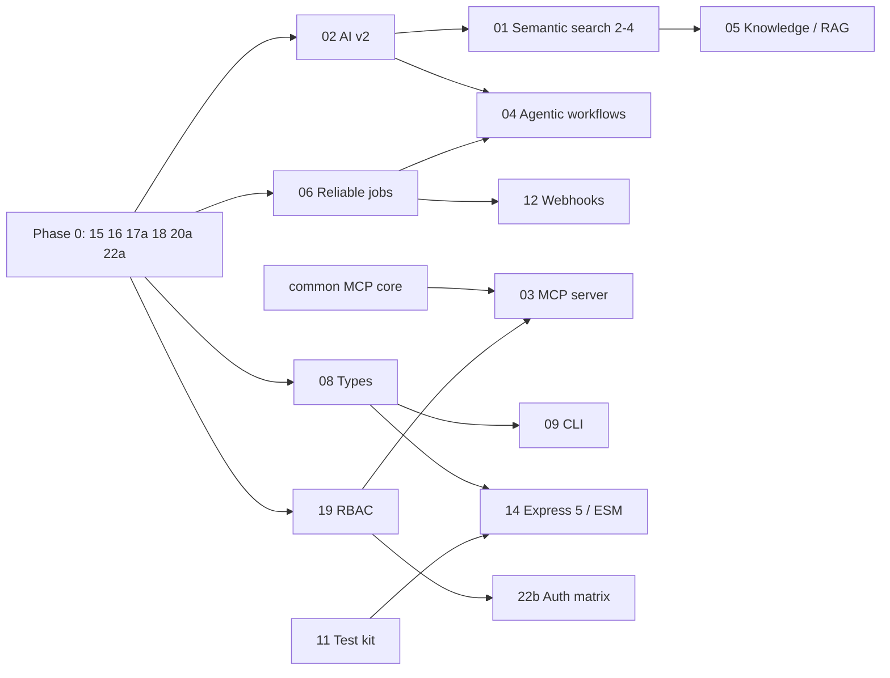

# NooblyJS Core Roadmap

**Created:** 2026-11-12 · **Owner:** NooblyJS Core team · **Review:** monthly
**Sources:** [Engineering acceleration features](features/00.%20Roadmap%20-%20Engineering%20Acceleration.md) · [Production readiness and security review 2026-11-12](go-to-market/PRODUCTION_READINESS_REVIEW_2026-11-12.md) · [Semantic search](features/01.%20Feature%20Searching%20Service%20Semantic%20Search.md)

## Why this order

Rank work by **impact ÷ effort**, but treat anything that blocks safe release as a gate, not a ranking:

1. **Can we ship it safely?** A reproduced chain lets an anonymous visitor read and write server files, and CI is red on dependency advisories. Nothing else matters to a customer until this is fixed.
2. **Does it unblock other work?** AI Service v2, reliable jobs and types each unblock several later features.
3. **Will engineers feel it every day?** The MCP server, knowledge service, CLI and OpenAPI change how fast teams build.
4. **Is it completeness?** Webhooks, feature flags and the Express 5 move are valuable but can wait.

## Done — Phase 0: Safe to ship (completed 2026-11-13)

**Goal:** close every critical and high finding and get CI green. **Exit:** the review's reproduction fails at every step, `npm audit --omit=dev --audit-level=high` passes, and the security regression tests are in the suite.

| # | Change | Impact | Effort |
|---|---|---|---|
| 20a | [Fix dependency advisories](features/20.%20Feature%20Dependency%20and%20Supply-Chain%20Hygiene.md) (`npm audit fix`, `simple-git` 4, `proxy-addr`) | CI green again; removes command-execution and IP-spoofing advisories | S |
| 15 | [Filing authorization and locked settings](features/15.%20Feature%20Filing%20Authorization%20and%20Locked%20Settings.md) | Closes C-1: arbitrary file read and write | M |
| 16 | [Invitation and onboarding hardening](features/16.%20Feature%20Invitation%20and%20Onboarding%20Hardening.md) | Closes C-2: anyone can create an account | S–M |
| 18 | [Code execution boundary](features/18.%20Feature%20Code%20Execution%20Boundary.md) | Closes H-3: any admin session or key can run any script | S–M |
| 17a | [Safe content serving](features/17.%20Feature%20Safe%20Content%20Serving%20and%20Strict%20CSP.md) (attachments for active types, sandbox header, safe type list) | Closes H-1: stored XSS against admins | S |
| 22a | [Exploit-chain regression tests](features/22.%20Feature%20Security%20Regression%20Suite%20and%20Continuous%20Verification.md) | Keeps the fixes fixed | S |

**Until Phase 0 ships:** deploy only on a private network, restrict filing `allowedTypes`, configure separate admin API keys, and block the public invitation and filing-settings routes at the proxy.

## Phase 1: Foundations (weeks 3–8): mostly done as of 2026-11-13

Done: 02, 08, 19, 23, 22b (ZAP baseline, gitleaks and the authorization matrix run on GitHub Actions and pass for 4f982f3), the `working` service, the dashboard panel and the named-instance routes of 06, and the Phase 1 part of 20. Still open: reliable jobs on the cloud queue providers (SQS, Azure, RabbitMQ, GCP, ActiveMQ), which need a store and a live service to test against; and the first scheduled run of the nightly audit (20b), which has not yet fired (the workflow is on the default branch and runs at 03:17 UTC). See the status line in each feature spec.

**Goal:** the building blocks every later feature needs, plus least-privilege access. **Exit:** one AI API with streaming, tools and embeddings; at-least-once jobs; typed public API; every route declares a permission.

| # | Change | Impact | Effort |
|---|---|---|---|
| 02 | [AI Service v2 on nooblyjs-ai-common](features/02.%20Feature%20AI%20Service%20v2%20on%20AI%20Common.md) | One AI API for every provider; unblocks semantic search Phase 2, RAG and agents; drops two SDKs | M |
| 06 | [Reliable jobs](features/06.%20Feature%20Reliable%20Jobs.md) | Retries, dead-letter queue and a consumer API; no more lost jobs | M |
| 08 | [TypeScript types and validated config](features/08.%20Feature%20TypeScript%20Types%20and%20Validated%20Config.md) | Autocomplete for people and coding agents; typos caught at start-up | M |
| 19 | [Route-level RBAC and scoped API keys](features/19.%20Feature%20Route-Level%20RBAC%20and%20Scoped%20API%20Keys.md) | Least privilege everywhere; no single guard to get wrong | M–L |
| 23 | [Session and token hygiene](features/23.%20Feature%20Session%20and%20Token%20Hygiene.md) | No tokens in URLs or script; idle timeouts | S–M |
| 22b | [Authorization matrix, ZAP baseline, secret scanning](features/22.%20Feature%20Security%20Regression%20Suite%20and%20Continuous%20Verification.md) | Authorization is tested on every pull request | M |
| 20b | [Nightly audit, Renovate, optional cloud SDKs](features/20.%20Feature%20Dependency%20and%20Supply-Chain%20Hygiene.md) | Advisories are noticed within a day; much smaller install | M |

## Done — Phase 2: What engineers will notice (completed 2026-11-13)

Every Phase 2 feature is done; each spec's status line records the evidence and what moved to Phase 3. Summary:

- **03 MCP:** checked live with the official MCP SDK client and a scoped personal access token: tools listed, writes refused, a failed workflow run diagnosed with MCP tools only. The check found and fixed three bugs (the login gate refused personal access tokens, `structuredContent` was an array, failed workflow steps were not logged).
- **01 Semantic search:** phases 2–4, an embedding error event, and an evaluate route for ranking quality. Open: a check against a live embedding provider.
- **05 Knowledge:** PDF sources, streamed answers, feedback, YAML evaluation with citation accuracy, a dashboard, and folder watching. Open: an evaluation with a real model.
- **10 OpenAPI:** every route documented (drift baseline empty), the merged document validated against the OpenAPI 3.1 schema, the typed client for the whole document compiled in CI.
- **09 CLI:** `add provider` (core checkout) and MongoDB and S3 checks in `doctor`. Moved to Phase 3: `add endpoint` and `add service` inside core.
- **11 Test kit:** contracts for dataservice, searching, authservice and git filing, plus AI Service v2 on the mock provider; two route test files rewritten with the kit; `nooblyjs-core/testing` export fixed. The contracts found four parity bugs, among them a file auth provider that forgot password changes on restart.
- **17b Strict CSP:** every dashboard handler checked in the browser; this found two dashboards (notifying, authservice) whose page scripts returned 404. Styles still allow `unsafe-inline` (Phase 3).

**Goal:** make NooblyJS the fastest way to build an AI-enabled Node.js service. **Exit:** a coding agent can operate a running app; teams can ship "ask our docs" in a day; `npx nooblyjs create` to a deployed app in under an hour.

| # | Change | Impact | Effort |
|---|---|---|---|
| 03 | [MCP server for the registry](features/03.%20Feature%20MCP%20Server.md) | Claude Code, Cursor and other agents can inspect and drive a running app | M |
| 01 | [Semantic search Phases 2–4](features/01.%20Feature%20Searching%20Service%20Semantic%20Search.md) | Real embeddings, semantic HTTP routes and UI | M |
| 05 | [Knowledge service (RAG)](features/05.%20Feature%20Knowledge%20Service%20RAG.md) | Cited answers over any filing source, synced incrementally | M |
| 10 | [Unified OpenAPI and generated clients](features/10.%20Feature%20Unified%20OpenAPI%20and%20Generated%20Clients.md) | One accurate spec; typed clients; docs can't drift | S–M |
| 09 | [Developer CLI](features/09.%20Feature%20Developer%20CLI.md) | `create`, `add`, `doctor`; conventions automated | M |
| 11 | [Test kit and provider contract tests](features/11.%20Feature%20Test%20Kit%20and%20Provider%20Contract%20Tests.md) | Shorter tests for app teams; provider parity proven | M |
| 17b | [Strict CSP (no `'unsafe-inline'`)](features/17.%20Feature%20Safe%20Content%20Serving%20and%20Strict%20CSP.md) | Closes the XSS class across all dashboards | M |

## Next — Phase 3: Scale and completeness

| # | Change | Impact | Effort |
|---|---|---|---|
| 04 | [Agentic workflows](features/04.%20Feature%20Agentic%20Workflows.md) | AI, agent, approval and branch steps with durable state | L |
| 21 | [Horizontal scaling readiness](features/21.%20Feature%20Horizontal%20Scaling%20Readiness.md) | Safe multi-replica deployments; no duplicate cron runs; closes review finding M-3 | M |
| 07 | [OpenTelemetry observability](features/07.%20Feature%20OpenTelemetry%20Observability.md) | End-to-end traces across HTTP, queues, workers and AI | M |
| 12 | [Webhooks and transactional outbox](features/12.%20Feature%20Webhooks%20and%20Outbox.md) | Reliable signed integrations | M |
| 13 | [Feature flags](features/13.%20Feature%20Feature%20Flags.md) | Safe rollouts on top of settings | S |
| 14 | [Express 5, ESM and Node 22](features/14.%20Feature%20Express%205%20ESM%20and%20Node%2022.md) | Modern platform; candidate for a 2.0 release with the legacy AI removal | M |

Carried over from Phase 2: a strict style policy (17b), `add endpoint` and `add service` inside core (09), S3 and cloud-provider contracts (11), live-provider checks for embeddings and knowledge answers (01, 05), reliable jobs on the cloud queue providers (06), and the production policy for general API keys on the data-plane API (they get 401 behind the login gate in production; decide whether data-plane keys should reach `/services/*/api` there), MCP `tools/list` filtered by the caller's permissions (calls are already checked), and Playwright runs writing `.application/` instead of `.temp/`.

Feature 04 moves to Phase 2 if a customer needs agentic automation sooner. Feature 21 moves earlier as soon as anyone deploys more than one replica.

## Dependencies

## Release plan

| Release | Contents | Target |
|---|---|---|
| **1.0.11** (security) | Phase 0 | End of week 3 |
| **1.1.0** | AI Service v2, reliable jobs, types, RBAC, session hygiene | Week 8 |
| **1.2.0** | MCP server, semantic search, knowledge service, OpenAPI, CLI, test kit | Week 16 |
| **2.0.0** | Express 5 / ESM / Node 22 baseline, legacy AI providers removed, strict CSP enforced | After 1.2 |

The package version is still 1.0.10, though the contents of 1.0.11, 1.1.0 and 1.2.0 are all done. Tag a release once CI is green on the pushed branch; one 1.2.0 release that covers all three is simplest.

## How we measure impact

| Measure | 2026-11-12 | 2026-11-13 (end of Phase 2) | Target |
|---|---|---|---|
| Open critical / high review findings | 2 / 3 | 0 / 0 | 0 / 0 by end of Phase 0 |
| Production advisories, high or critical | 11 | 0 | 0, held by a nightly audit |
| Routes with a declared permission | 0 | 100% (start-up fails otherwise in strictAuth) | 100% by end of Phase 1 |
| Routes with OpenAPI documentation | not measured | 100% (drift baseline empty) | 100% |
| Statement coverage threshold | 51% | 76% (actual 78.0%) | 65% by end of Phase 2 |
| Time from `npx nooblyjs create` to a running app with auth | not possible | the CI `templates` job generates, installs and tests three templates | under 10 minutes |
| AI providers behind one API | 6 legacy + 7 in common, split | AI Service v2 (`complete`, `stream`, tools, `embed`) for anthropic, openai-compatible, bedrock, vertex, azure and mock; the legacy names (claude, openai, ollama, gemini) keep their old classes unless `legacy: false` | 1 API, 9 providers |
| Providers passing a contract suite | 0 | caching (memory, Redis), queueing (memory, Redis), filing (local, git), dataservice (memory, file, MongoDB), searching (memory, vector), authservice (memory, file), AI (mock) | caching, queueing, dataservice, filing |

## Housekeeping

- **Docs:** update `Application Architecture.md`, `Product Requirements.md` and both usage guides at the end of each phase. Last checked against the code on 2026-11-13 (Phase 2 pass).
- **Trackers:** the review's finding table (`go-to-market/PRODUCTION_READINESS_REVIEW_2026-11-12.md`, "Status on 2026-11-13") and each spec's status line are the trackers. There is no separate remediation or dependency file.
- **Spec locations:** feature specs and the review live under `.claude/steering/` (`features/`, `go-to-market/`), as CLAUDE.md and `.claude/rules/output-locations.md` say. They were moved from `.claude/specs/` on 2026-11-13.
